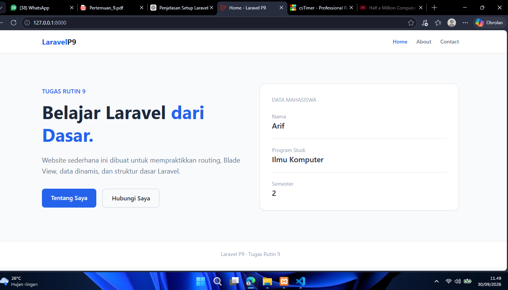

# TugasWeb-P9-LaravelSetup

Project ini dibuat untuk memenuhi **Tugas Rutin 9 — Setup Laravel**.

## Requirements

* Laravel
* PHP
* Composer
* MySQL / XAMPP
* phpMyAdmin

## Cara Menjalankan Project

### 1. Clone Repository

```bash
git clone <URL_REPOSITORY>
cd TugasWeb-P9-LaravelSetup
```

### 2. Install Dependency

```bash
composer install
```

### 3. Konfigurasi Environment

Salin file `.env.example` menjadi `.env`:

```bash
cp .env.example .env
```

Kemudian buat database melalui **phpMyAdmin**, misalnya:

```text
tugasweb_p9
```

Sesuaikan konfigurasi database pada file `.env`:

```env
DB_CONNECTION=mysql
DB_HOST=127.0.0.1
DB_PORT=3306
DB_DATABASE=tugasweb_p9
DB_USERNAME=root
DB_PASSWORD=
```

### 4. Generate Application Key

```bash
php artisan key:generate
```

### 5. Jalankan Migration

```bash
php artisan migrate
```

### 6. Jalankan Laravel

```bash
php artisan serve
```

Kemudian buka:

```text
http://127.0.0.1:8000
```

## Fitur yang Dibuat

### Route

Project memiliki beberapa route:

| Route           | Fungsi          |
| --------------- | --------------- |
| `/`             | Halaman Home    |
| `/about`        | Halaman About   |
| `/contact`      | Halaman Contact |
| `/hello/{nama}` | Route parameter |

### Blade View

View yang digunakan:

```text
resources/views/
├── home.blade.php
├── about.blade.php
├── contact.blade.php
└── hello.blade.php
```

Data dinamis dikirim dari route menggunakan array dan ditampilkan pada Blade menggunakan syntax:

```php
{{ $nama }}
```

### Controller dan Model

Controller dibuat menggunakan:

```bash
php artisan make:controller HomeController
```

Model dan migration dibuat menggunakan:

```bash
php artisan make:model Product -m
```

## Struktur Folder Utama

```text
TugasWeb-P9-LaravelSetup/
├── app/
│   ├── Http/
│   │   └── Controllers/
│   └── Models/
│
├── database/
│   └── migrations/
│
├── public/
│   └── image.png
│
├── resources/
│   └── views/
│       ├── home.blade.php
│       ├── about.blade.php
│       ├── contact.blade.php
│       └── hello.blade.php
│
├── routes/
│   └── web.php
│
├── .env.example
├── artisan
├── composer.json
└── README.md
```

## Teknologi

* Laravel
* PHP
* MySQL
* Blade
* Tailwind CSS CDN

## Screenshot

Berikut dokumentasi halaman Laravel yang berhasil dijalankan:

